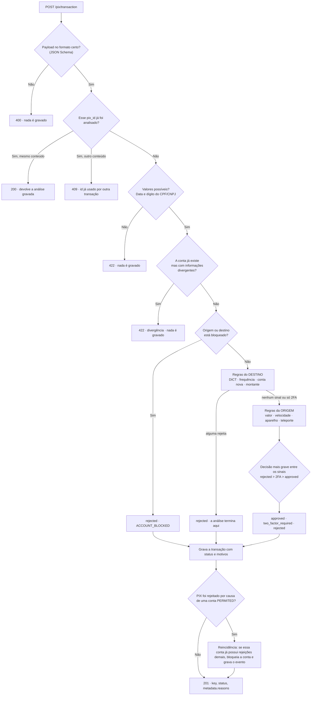

# Grupo 9
**Integrantes:** Henrique Segala de Moura, Carlos Lopes Mesquita Neto, Pedro Sakon Peixoto

## Como o motor de decisão funciona

O motor é uma API que recebe um Pix, decide se ele pode acontecer (`approved`), pede um autenticação (`two_factor_required`) ou rejeita sua conclusão. Cada Pix recebido fica gravado e consultável, inclusive os rejeitados.




Três princípios guiaram o desenho:

- **Tempo.** Tudo é decidido com consultas ao próprio banco, indexadas. A única chamada externa (o DICT) tem timeout extremamente baixo (de 0,3 s). Se falhar, o motor segue sem ela.
- **Histórico.** As regras comparam o Pix com o que o pagador e o recebedor já fizeram: janelas de tempo, percentil de valor, média diária, aparelhos já usados, última localização... As janelas usam o horário do **servidor**, nunca o `transaction_date` do payload, que o cliente controla.
- **Fricção.** Rejeição só quando o risco é claro. Sinal de dúvida vira 2FA, que o cliente legítimo resolve confirmando que é ele.

Toda decisão sai com o motivo em `metadata.reasons`:

```json
{ "key": "cc9961b2-5f18-4a3c-898d-7443fd48110b", "status": "two_factor_required", "metadata": { "reasons": ["SRC_NEW_DEVICE"] } }
```

`metadata` é `{}` quando o Pix é aprovado.

## Regras

CPF e CNPJ têm comportamentos diferentes: por exemplo, uma empresa recebe e envia muito mais que uma pessoa. Por isso essa e outras regras têm parâmetros separados entre CPF e CNPJ.
### Destino (quem recebe)

| Regra | Lógica | Parâmetros | Por quê |
|-------|--------|------------|---------|
| **Marcação no DICT** `DEST_FRAUD_MARKED` | Consulta o DICT pelo documento do destino e soma as marcações de conta laranja, conta de golpista e fraude de cadastro dos últimos 90 dias. Marcado → **rejected** | ≥ 1 marcação; janela `d90`; timeout 0,3 s | O DICT é onde os bancos registram contas usadas em fraude: é um sinal forte sobre o recebedor. Escolhemos só a janela `d90` porque inclui o mês atual e informações essenciais de fraude. Se o DICT não responder no timeout, o Pix segue sem ele |
| **Frequência de recebimento (CPF)** `DEST_RECEIVING_VELOCITY` | Analisa a frequência dos PIX´s recebidos pelo CPF que saem do nosso banco, em três janelas. Passou de qualquer uma → **rejected** | Mais de 3 em 1 s; mais de 10 em 1 min; mais de 100 em 1 h | É o padrão da conta de passagem: muitas vítimas pagando o mesmo laranja. As janelas pegam rajadas automatizadas em diferentes escalas. Contar pelo **documento** impede o laranja de espalhar o dinheiro em várias contas|
| **Conta nova com muitos pagadores (CPF)** `DEST_NEW_ACCOUNT` | Se a conta tem menos de 5 dias: quantifica as contas **distintas** que transfiriram para essa desde a abertura | Mais de 20 → **2FA**; mais de 50 → **rejected** | Conta laranja costuma ser recém-aberta e receber de muitas pessoas diferentes.|
| **Montante recebido (CNPJ)** `DEST_HIGH_AMOUNT` | Soma recebida nas últimas 24 h (contando o Pix atual) comparada com um limite que depende da situação da empresa. Acima → **2FA** | Conta com menos de 30 dias: limite é R$ 50.000. Conta antiga com histórico e com mais de 60 recebimentos nos 30 dias anteriores: limite corresponde a 3× da média diária| Empresa de fachada recebendo golpe em massa aparece como volume fora do padrão. Comparar com a **própria média** respeita o porte de cada empresa (uma padaria e uma loja grande têm números muito diferentes). 3× deixa passar um dia de vendas forte.|

Rejeição do destino encerra a análise. Caso passe, segue para a origem.

### Origem (quem paga)

| Regra | Lógica | Parâmetros | Por quê |
|-------|--------|------------|---------|
| **Valor** `SRC_HIGH_AMOUNT` | Olha para o Pix e compara com um limite. Se estiver acima e a conta não tiver histórico → **2FA**; se tiver histórico e o valor passar de 1,5× do percentil 95 do que a conta costuma enviar → **2FA** | Limite sem histórico: R$ 2.000 (CPF) e R$ 100.000 (CNPJ) | Valor alto fora do padrão é o sinal clássico de conta invadida e de golpe. Escolhemos o percentil 95 pois representa o topo das transações habituais.|
| **Velocidade de envio (CPF)** `SRC_SENDING_VELOCITY` | Pix enviados pela conta nos últimos 2 minutos | Mais de 3 → **2FA**; mais de 10 → **rejected** | Conta invadida é esvaziada em sequência. Dois degraus: pagar algumas contas seguidas pede só uma confirmação; dez em dois minutos já não é comportamento humano |
| **Rajada de envios (CNPJ)** `SRC_SENDING_VELOCITY` | Número de envios na última hora da empresa. Com esse número, comparamos com a média por hora da própria empresa nos 30 dias anteriores | Se a empresa possui histórico (mais de 60 envios), o limite é definido como o max(6*média_envios , 20). Caso contrário o limite é 15. Se o número de PIXs na última hora passa do limite em qualquer um desses 2 casos -> **2FA** .| Empresa tem rajadas legítimas (folha de pagamento, fornecedores), por isso a regra só pede 2FA.|
| **Aparelho novo** `SRC_NEW_DEVICE` | Se e `device_id` nunca foi usado pela conta num Pix aprovado ou com 2FA → **2FA** | — | Aparelho desconhecido é o sinal mais comum de conta invadida, e é exatamente o que o 2FA resolve (o fraudador não tem o segundo fator). O primeiro Pix de toda conta pede 2FA. Pix **rejeitado** não reconhece o aparelho. |
| **Teleporte** `SRC_LOCATION_MISMATCH` | Distância entre este Pix e o último Pix **aceito** com localização, dividida pelo tempo entre eles. CPF compara com o último Pix da conta; CNPJ, com o último do **mesmo aparelho**. Sem localização, a regra não roda. | Mais de 900 km/h e pelo menos 50 km de distância | Ninguém está em São Paulo e, minutos depois, em Recife: é um aparelho clonado ou a conta usada em outro lugar. 900 km/h é a velocidade de um avião comercial, então uma viagem de verdade passa. Abaixo de 50 km é ruído de GPS.|

### Bloqueio da conta (reincidência)

| Regra | Lógica | Parâmetros | Por quê |
|-------|--------|------------|---------|
| **Reincidência** | Quando um Pix é rejeitado por risco, o motor olha os últimos Pix da conta **no mesmo papel** (destino ou origem). Rejeições demais → a conta vira `PROHIBITED`, e todo Pix seguinte dela é rejeitado com `ACCOUNT_BLOCKED` até um desbloqueio manual | Últimos 30 Pix, nos últimos 30 dias, desde o último desbloqueio. Destino: mais de 8 rejeições. Origem: mais de 10 | Uma conta que é barrada repetidamente não deve continuar tentando. A origem exige **mais** evidência porque é cliente do banco: um bloqueio errado ali custa mais caro. A janela impede que rejeições antigas se acumulem para sempre. Rejeições por `ACCOUNT_BLOCKED` não contam, senão o bloqueio se alimentaria sozinho |

Todos os parâmetros ficam em `src/parameters.py`, com o mesmo valor deste README.

## Como as regras viram decisão

1. **Idempotência primeiro.** O `id` do Pix é único. Reenviar o mesmo Pix devolve a análise gravada (HTTP 200), sem reanalisar. Reenviar o mesmo `id` com **outro conteúdo** é recusado (409): o motor guarda um hash SHA-256 do payload, e devolver a análise antiga seria aprovar uma transação que nunca foi analisada.
2. **Conta bloqueada** (origem ou destino) → `rejected` com `ACCOUNT_BLOCKED`, sem rodar regra nenhuma.
3. **Destino.** O DICT roda primeiro. Se alguma regra do destino **rejeitar**, a análise termina aí. Se pedir **2FA**, a análise **continua** para a origem.
4. **Origem.** Todas as regras da origem rodam e cada uma gera, ou não, um sinal.
5. **Combinação:**
   - vale a decisão **mais grave**: `rejected` > `two_factor_required` > `approved`;
   - **sinais não se somam**: vários sinais de 2FA continuam dando 2FA. O 2FA já resolve a dúvida de identidade, e somar transformaria o atrito em recusa;
   - nenhum sinal → `approved`;
   - `metadata.reasons` traz **todos** os motivos: primeiro os de rejeição, depois os de 2FA, cada grupo na ordem do fluxo.
6. **Gravação.** O Pix é gravado com a decisão e os motivos. Se foi rejeitado por risco, o motor confere a reincidência e, se for o caso, bloqueia a conta e grava o evento **na mesma transação de banco**.

**Quando pede 2FA:** Como observado acima, o 2FA é retornado com base nas regras de destino e origem, em casos onde uma ação é suspeita, mas não o suficiente para ser considerada uma transação de alto risco para o banco, podendo ser justificadas com base em exceções plausíveis

**Quando rejeita:** Como observado acima, uma transação é rejeitada quando ela possui um comportamento excessivamente suspeito ou envolve contas bloqueadas pelo sistema.

## Como rodar e testar

### Pré-requisitos

- Docker (com `docker compose`)
- Python 3.11+ (só para os testes)

### Subir a API

```bash
docker compose up --build
```

### Rodar os testes

Os testes rodam na sua máquina, contra a API no Docker, por HTTP.

```bash
python3 -m venv .venv
source .venv/bin/activate        # Windows: .venv\Scripts\activate
pip install -r requirements-dev.txt
pytest
```

Caso necessário, no Windows, crie um `.env` (copiando o `.env.example`) com `SERVER_LOCALHOST=localhost`.

